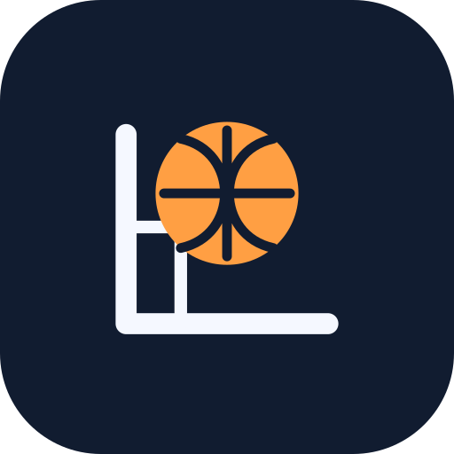
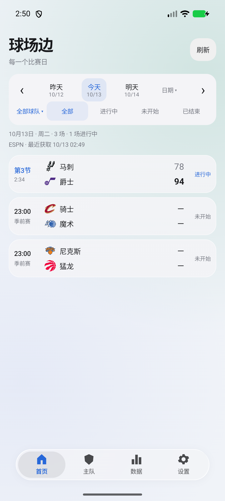
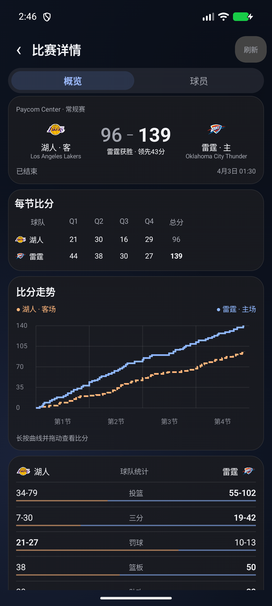
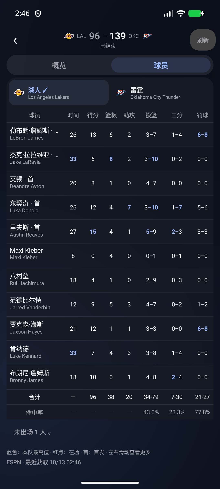
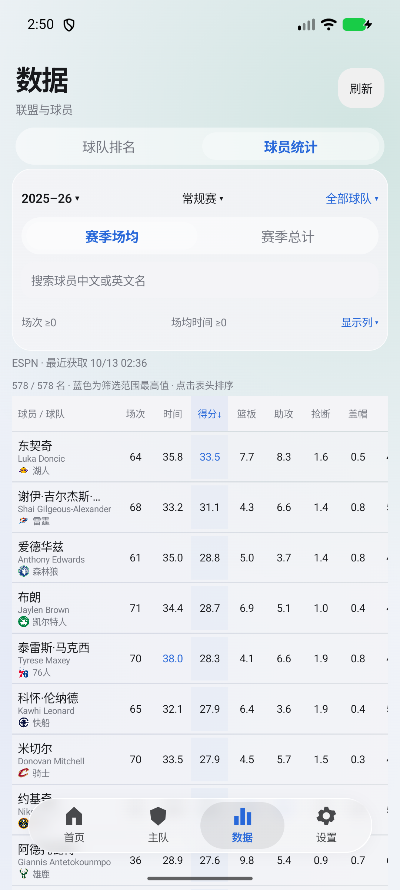
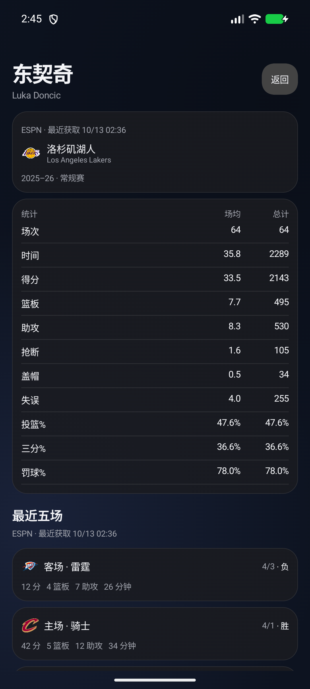

# 球场边 · Courtside



以关注主队、查看比赛为核心的原生 Android NBA 工具。使用 Kotlin、Jetpack Compose 和 **miuix**，配合卡片布局与液态玻璃材质，提供中文界面和真实赛事数据。

[下载 APK](https://github.com/BURN1ngZ828/Courtside/releases/latest) · [更新日志](CHANGELOG.md) · [问题反馈](https://github.com/BURN1ngZ828/Courtside/issues) · [数据说明](docs/DATA_SOURCES.md)

当前版本 **1.0.0 正式版**。应用名称为「球场边」，Android 包名与维护者发布签名沿用旧版，支持覆盖更新。

## 界面

  

 

截图来自模拟器，展示截图时获取的数据，不代表当前比分。

## 功能

- **首页赛程**：昨天／今天／明天、日历跳转、吸顶筛选；全部／关注球队与进行中／未开始／已结束状态，紧凑比赛行、比分与场数摘要。
- **多个主队**：设置中添加、移除、长按拖动或箭头排序；主队页切换球队，查看战绩、下一场、近五场胜负与近期赛程。自动迁移旧单主队设置。
- **数据**：东西部排名与全联盟球员统计。赛季场均／总计、赛季及常规赛／季后赛、球队、双语姓名搜索、出场场次及时间筛选；表头排序、可选统计列及排列，保存排序、统计模式和列设置。
- **球员详情**：完整中英文名、球队标识、所选赛季场均与总计、最近五次出场记录，可进入对应比赛详情。
- **比赛详情**：概览与球员两个入口，各自保存滚动位置；队标、比分、主客场、场馆、分节、真实逐次比分曲线、球队比较。固定双语姓名列、吸顶表头、同步横向滚动、球队合计与命中率、未上场球员折叠、首发与在场分开标识。
- **清晰颜色**：领先比分加粗、落后方减弱，明确领先分差或获胜方。统计最大值统一蓝色，实际在场姓名为红色；双队颜色集中于曲线及比较图，不把整张统计表染色。
- **轻量卡片与液态玻璃**：深色／浅色／系统，普通卡片使用轻量渐变与透明材质，实时模糊和折射集中于四项悬浮底栏；实体选中胶囊、弹簧动画、按压反馈和页面过渡。
- **真实缓存**：ESPN 数据、最近成功获取时间、手动刷新、失败保留缓存；前台按需刷新、后台停止持续轮询。没有数据时不填入演示比分。
- **本地资源**：30 队队标与 622 条球员中文名，稳定 ID 匹配，未知球员保留英文；原创「球场边线＋篮球」自适应及单色图标。

没有新闻、社区、视频、投注、防剧透、后台通知或桌面小组件。全联盟统计是来源提供的完整出场名单，不冒充官方合格榜单；转会球员合并赛季只显示一次。当前赛季尚未产生统计时显示空状态，可主动切换上一赛季。

## 安装

从 [Releases](https://github.com/BURN1ngZ828/Courtside/releases) 下载 APK，在 Android 手机上安装。最低 Android 7.0（API 24）。维护者发布 APK 沿用同一签名，支持覆盖更新。

1.0.0 使用 **非调试 release 构建**，启用 R8 与资源压缩。为保持覆盖安装，维护者仍沿用最初的本机开发签名证书；这不是新引入的生产签名体系。自行构建、CI 与维护者签名可能不同，不保证互相覆盖安装。签名密钥不提交。

Android 12（API 31）起启用玻璃模糊，Android 13（API 33）起启用镜片折射；旧版本使用半透明材质、高光与阴影。实际效果与设备 GPU 和系统有关，不依赖小米系统专有组件。

## 构建

| 项目 | 锁定版本 |
| --- | --- |
| JDK | 21 |
| Gradle | 9.7.1（Wrapper） |
| Android Gradle Plugin | 9.4.1 |
| Kotlin Compose compiler | 2.4.20 |
| miuix | 0.9.4 |
| Backdrop | 2.0.1 |
| Android SDK | compile 37、target 36、min 24 |

安装 Android Studio 或 Android SDK，设置 `ANDROID_HOME`，或在不提交的 `local.properties` 中填写自己的 `sdk.dir`。首次构建需要下载 SDK 和 Maven 依赖。

```powershell
# Windows
.\gradlew.bat :app:assembleRelease :app:testDebugUnitTest
```

```sh
# macOS / Linux
./gradlew :app:assembleRelease :app:testDebugUnitTest
```

APK 位于 `app/build/outputs/apk/release/app-release.apk`。无需账户、API Key 或服务端配置。CI 产物供验证，不会自动替代维护者签名的 Release。

## 数据与准确性

ESPN 公开网站接口并非承诺长期稳定的开发者 API，可能限流、失效、延迟或改变字段。本项目没有购买服务或官方合作关系。接口、缓存、时区与统计限制见 [数据说明](docs/DATA_SOURCES.md)。

曲线仅展示来源提供的真实逐次记录，缺失时明确提示；不造开场与终点。不以首发名单推测在场状态，缓存过期、请求失败或比赛结束时取消在场标记。统计最高值表示数量最大，不表示失误、犯规等指标越高越好。

## 验证与迭代

1.0.0 优化 release 构建及 28 项单元测试通过，覆盖时区、解析、异常状态、多主队迁移、统计最高值、比分曲线、领先判断、赛季验证、空状态、真实累计数值、命中率与常规赛／季后赛记录隔离。2025–26 常规赛接口六页共 578 名球员，核对无重复和漏页；2026–27 尚未产生常规赛统计，不以旧赛季填充。

已在 API 37 模拟器检查覆盖更新、四页面、全量统计、场均／总计、排序与列设置、球队切换、双语搜索、球员近期记录、详情、横向滚动与主题。手机上的流畅度和旧 Android 材质降级仍需实际设备反馈。

历史版本保留在 Releases。**0.1.0、0.2.0 有原始源码快照；0.1.1 只有原始 APK，未保存准确源码快照**。见 [源码存档说明](docs/SOURCE_PROVENANCE.md)，不将后来的源码误标为旧 APK 构建源码。

提交修改前请阅读 [贡献说明](CONTRIBUTING.md)。发布流程见 [docs/RELEASING.md](docs/RELEASING.md)。

## 许可证

自有源码采用 [Apache License 2.0](LICENSE)。依赖、球队商标与队标、赛事数据及名称资料保留各自权利；源码许可证不赋予这些资源的商业分发许可。见 [资源来源](ASSET_SOURCES.md) 和 [第三方说明](THIRD_PARTY_NOTICES.md)。

视觉排版参考用户提供的 F1Info、Apple Music、虎扑与酷安截图，仓库不包含参考截图或第三方人物照片。
