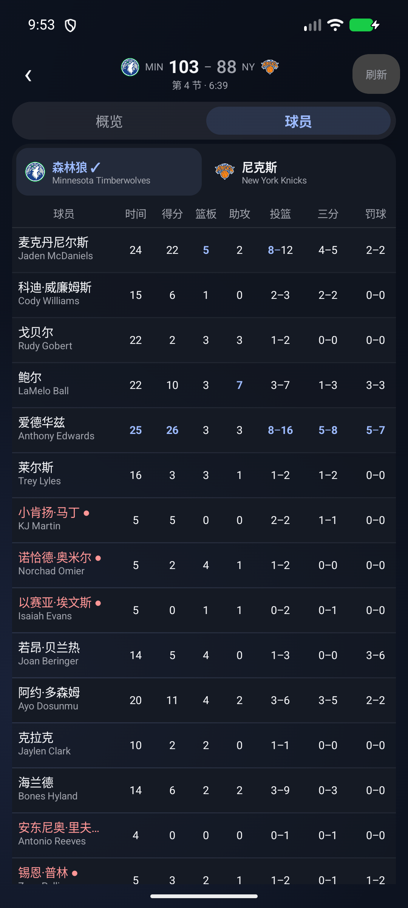

# Courtside 球场边

以关注主队、查看比赛为核心的原生 Android NBA 工具。使用 Kotlin、Jetpack Compose 和 **miuix**，配合卡片布局与液态玻璃材质，提供中文界面和真实赛事数据。

[下载 APK](https://github.com/BURN1ngZ828/Courtside/releases/latest) · [更新日志](CHANGELOG.md) · [问题反馈](https://github.com/BURN1ngZ828/Courtside/issues) · [数据说明](docs/DATA_SOURCES.md)

当前版本 **0.4.0**，供安装调试，欢迎反馈手机上的显示与网络问题。

## 界面

  



截图来自模拟器，展示截图时获取的数据，不代表当前比分。

## 功能

- **多个主队**：设置中添加或移除；首页切换球队，分别查看进行中、下一场和最近一场。自动迁移旧版本单主队设置。
- **四个页面**：首页、赛程、排名、设置。悬浮玻璃底栏内有覆盖图标与标签的选中胶囊，以弹簧动画滑动；保留按压反馈、页面过渡及滚动位置。
- **卡片与玻璃**：浅色、深色、跟随系统；按系统版本启用背景采样、模糊、折射、高光和阴影，统计正文保持清晰。
- **赛程**：设备本地日期、日期跳转、全部／当前主队／所有关注球队筛选，显示比分与比赛状态。
- **比赛详情**：概览与球员两个入口，各自保存滚动位置；滚动后顶部保留队标和比分。场馆与比赛类型同一行，主客队、中英文队名、分节比分及真实逐次比分曲线完整呈现。
- **球员统计**：紧凑双语姓名列与行高，固定姓名、吸顶表头、同步横向滚动；点击姓名查看完整中英文名。普通数值使用中性色，本队最高值含并列以蓝色标记；正负值按实际有符号数比较。在场球员姓名与圆点为红色。刷新保留首次获取的球员排列。
- **比分与颜色**：领先方比分加粗，落后方减弱；详情明确显示领先分差或获胜球队。双队颜色集中用于曲线和对比细条，主队蓝色、客队橙色，曲线同时用实／虚线区分。
- **数据与缓存**：ESPN 真实数据、最近成功获取时间、手动刷新、失败保留缓存。前台进行中比赛适度刷新，后台停止持续轮询。
- **本地资源**：30 队队标、622 条中文球员名，按稳定 ID 匹配；比赛常用显示名参考虎扑，未知球员保留英文。

没有新闻、社区、视频、投注、防剧透、后台通知或桌面小组件。排名为常规赛东西部排名，不以季前赛比分编造战绩。

## 安装

从 [Releases](https://github.com/BURN1ngZ828/Courtside/releases) 下载 APK，在 Android 手机上安装。最低 Android 7.0（API 24）。维护者发布 APK 沿用同一签名，支持覆盖更新。

目前发布的是 **debug 测试包**。自行构建、CI 构建和维护者发布包可能签名不同，不能保证互相覆盖安装。不要为此随意卸载已有应用，以免丢失本地主队与设置。

Android 12（API 31）起启用玻璃模糊，Android 13（API 33）起启用镜片折射；旧版本使用半透明材质、高光与阴影。实际效果与设备 GPU 和系统有关，不依赖小米系统专有组件。

## 构建

| 项目 | 锁定版本 |
| --- | --- |
| JDK | 21 |
| Gradle | 9.7.1（Wrapper） |
| Android Gradle Plugin | 9.4.1 |
| Kotlin Compose compiler | 2.4.20 |
| miuix | 0.9.4 |
| Backdrop | 2.0.1 |
| Android SDK | compile 37、target 36、min 24 |

安装 Android Studio 或 Android SDK，设置 `ANDROID_HOME`，或在不提交的 `local.properties` 中填写自己的 `sdk.dir`。首次构建需要下载 SDK 和 Maven 依赖。

```powershell
# Windows
.\gradlew.bat :app:assembleDebug :app:testDebugUnitTest
```

```sh
# macOS / Linux
./gradlew :app:assembleDebug :app:testDebugUnitTest
```

APK 位于 `app/build/outputs/apk/debug/app-debug.apk`。无需账户、API Key 或服务端配置。CI 产物供验证，不会自动替代维护者签名的 Release。

## 数据与准确性

ESPN 公开网站接口并非承诺长期稳定的开发者 API，可能限流、失效、延迟或改变字段。本项目没有购买服务或官方合作关系。接口、缓存、时区与统计限制见 [数据说明](docs/DATA_SOURCES.md)。

曲线仅展示来源提供的真实逐次记录，缺失时明确提示；不造开场与终点。不以首发名单推测在场状态，缓存过期、请求失败或比赛结束时取消在场标记。统计最高值表示数量最大，不表示失误、犯规等指标越高越好。

## 验证与迭代

0.4.0 debug 构建及 21 项单元测试通过，覆盖时区、解析、异常状态、多主队迁移、加时、统计最高值、比分曲线与领先判断。已在 API 37 模拟器检查覆盖安装、紧凑界面、详情切换、统计横滑、完整姓名、小屏大字体与主题。真实手机上的运行与流畅度仍待反馈，旧 Android 的玻璃降级尚未实机验证。

历史版本保留在 Releases。**0.1.0、0.2.0 有原始源码快照；0.1.1 只有原始 APK，未保存准确源码快照**。见 [源码存档说明](docs/SOURCE_PROVENANCE.md)，不将后来的源码误标为旧 APK 构建源码。

提交修改前请阅读 [贡献说明](CONTRIBUTING.md)。发布流程见 [docs/RELEASING.md](docs/RELEASING.md)。

## 许可证

自有源码采用 [Apache License 2.0](LICENSE)。依赖、球队商标与队标、赛事数据及名称资料保留各自权利；源码许可证不赋予这些资源的商业分发许可。见 [资源来源](ASSET_SOURCES.md) 和 [第三方说明](THIRD_PARTY_NOTICES.md)。

视觉排版参考用户提供的 F1Info、Apple Music、虎扑与酷安截图，仓库不包含参考截图或第三方人物照片。
